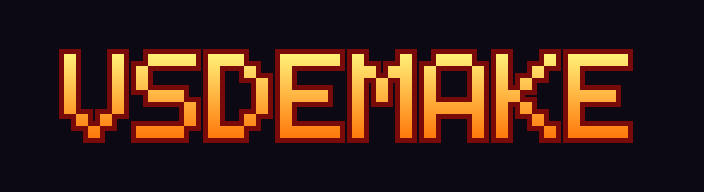

# vsdemake


[](https://ko-fi.com/spikethedragon)
[](https://buymeacoffee.com/spike_the_dragon)

An unofficial Xbox 360 homebrew demake of Vampire Survivors: a C99
gameplay engine built as `default.xex` with the Xbox 360 XDK. It is played
on Xbox 360 only (see [Why Xbox 360 only](#why-xbox-360-only)).

The project separates the engine from the original game's content:

- **Engine:** a reimplementation using documented gameplay behaviour.
- **Patcher:** a Node.js tool that reads files from your own legally
  purchased Steam copy of Vampire Survivors and converts the required
  data and assets into a pack the engine can load.

The project does not distribute the original Vampire Survivors source
code, game assets, or generated data packs. You must own Vampire Survivors
on Steam and supply the supported game files yourself.

> **Status: 1.0.0 release candidate.** The game is playable on Xbox 360
> hardware (XDK build) with the content of 0.2.10: both
> stages, the 13 characters, the weapons and evolutions, the shop, the
> treasure scene, the collection and achievements, saves, and sound and
> music. Console performance in long sessions is still being checked.
>
> What changed: [CHANGELOG.md](CHANGELOG.md). Development log:
> `notes/progress.md`.

---

## Features

- **Stages:** Mad Forest and Inlaid Library, with their music. The Library
  unlocks as in the original (reach level 20 in Mad Forest).
- **Characters:** the 13 playable characters: the starting ones, plus the
  hidden ones once their unlock is earned, bought at the character select.
- **Weapons:** Whip, Magic Wand, Knife, Axe, Cross, King Bible, Fire Wand,
  Garlic, Santa Water, Runetracer, Lightning Ring, Peachone, Ebony Wings,
  Clock Lancet, Laurel and Bone: every weapon of this version except
  Pentagram, which is left out on purpose (it is never offered).
- **Evolutions:** Bloody Tear, Holy Wand, Thousand Edge, Death Spiral,
  Heaven Sword, Unholy Vespers, Hellfire, Soul Eater and Vandalier (the
  union of Peachone and Ebony Wings). They come from
  treasure chests, with the original's rules (max-level weapon plus the
  matching passive item).
- **Passive items:** all 14, with their effect on every stat.
- **Level-up screen:** like the original's. Each choice shows its icon,
  name, "New!" or its level, and what the item does or what this level
  adds (for example "Base damage up by 5"). The text is built from the
  game's own English strings when the pack is made.
- **Enemies:** the version's enemies, bosses and stage events; Shade bombs
  flash a red ring that speeds up, then explode.
- **Pickups:** gems, gold, coin bags, Floor Chicken, hearts, Vacuum,
  Rosary, Orologion (with its blue time-stop flash), Clover, Nduja Fritta
  (10 s of fire breath) and
  treasure chests, dropped by candles with the original's odds (about 80 %
  money at the start; the rarer items unlock at player levels 4–12 and
  Luck makes them likelier).
- **Treasure chests:** the original's opening screen: press OPEN, the chest
  bursts open with coins, ribbons and reels of item icons, the gold counter
  ticks up, the prizes pop in, then DONE; the big chest adds fireworks, and
  bubbles rise behind the panel. Experienced players can skip the
  animation with B, as in the original.
- **Map bonus items:** the passives hidden far out on the Mad Forest and
  Inlaid Library maps (Might, Luck, Max Health, Recovery, Greed,
  Cooldown) appear by chance (Luck helps); picking one up opens the
  "Weapon Found!" screen to take or leave it.
- **Power Up shop:** spend gold on the original's 14 permanent bonuses
  (Might, Armor, Max Health, Recovery, Cooldown, Area, Speed, Duration,
  Amount, Move Speed, Magnet, Luck, Growth, Greed), with the original's
  prices and the refund button; characters are bought at the character
  select, as in the original.
- **Collection and achievements:** the original's two menu screens: every
  weapon and item found so far, and the 40 achievements with what each one
  unlocks.
- **Saves and unlocks:** gold, lifetime totals, the original's 40
  achievements, unlocked items, characters and stages (see
  [Saves and unlocks](#saves-and-unlocks)).
- **Sound and music:** the original's sound effects and stage tracks,
  played with the original's volume, pitch and repeat rules (see
  [Sound and music](#sound-and-music)).
- **Pause and options:** the original's pause screen (volumes, Flashing
  VFX, Damage Numbers, Quit/Resume), also reachable from the title menu
  (see [Pause and options](#pause-and-options)).
- **Look:** additive blending where the original uses it (glows, trails,
  explosions, the chest scene) and a Courier-style font like the original's
  menus.
- **Title screen and menus:** the demake's own background art (dimmed
  behind the other menus).
- **Character and stage select:** laid out like the original's: character
  cards (silhouettes for the ones not bought yet), the stats panel with
  your bought power-ups, then the stage cards with their pictures; confirm
  once, then START.
- **Platform:** Xbox 360 (XDK). The engine also builds on PC as a
  headless test tool for development only (no window, controls or sound
  output); the game cannot be played on PC.

## How it works

```text
Your supported Steam depot files
              |
              v
       Local Node.js patcher
              |
              v
        vsdata.vspack
              |
              v
    vsdemake on Xbox 360 (default.xex)
```

The patcher reads the game files without executing the original game.
It converts textures, atlases, maps, fonts, language strings and gameplay
tables, and copies the game's OGG Vorbis sounds unchanged, into a single
binary pack. The engine decodes the sounds itself at run time.

The title screen's background art is part of this repository
(`engine/assets/title_bg.png`, built into `default.xex`). The “VSDEMAKE”
lettering on the character select is generated locally: the patcher
assembles it from the user's original title image, and the texture is
stored in the generated pack, not distributed as a project asset.

Patching does not upload game files or download additional content.
Installing the patcher's dependencies with `npm install` may require
network access.

**Do not distribute `vsdata.vspack`, extracted game data, converted assets,
or de-obfuscated game source.**

## Why an old version?

The demake targets the early Electron/Phaser version of Vampire Survivors.
Its data and assets are in formats supported by the patcher.

Supported build:

| Steam app | Depot | Manifest | Game version |
| --- | --- | --- | --- |
| 1794680 | 1794681 | `8292959317163221061` | 0.2.10 |

Other manifests are not supported. The patcher checks hashes against the
known build. The `--allow-unknown` override is intended for development
and does not make another build supported.

## Why Xbox 360 only

Vampire Survivors is sold and actively developed on PC (and on other
platforms) by poncle. vsdemake does not want to compete with it or be an
alternative way to play it there: on PC, the right way to play Vampire
Survivors is to buy and play the original, which is far bigger and better
than this early version.

The demake exists for a different reason: to bring an early build of the
game, as a homebrew technical exercise, to a console the original never
shipped on. So the project only builds a playable `default.xex` for the
Xbox 360. The engine still compiles on PC, but only as a headless test
tool for development (automated runs, screenshots and regression
checks): it has no window, no controls and no sound output.

## Install

There is nothing to download from this project but its source: the game
data comes from your own Steam copy, and the console executable is built
with your own XDK. In short:

1. **Get the game files:** download the supported Steam build
   ([Step 1](#step-1-download-the-supported-build-from-steam)).
2. **Build the data pack:** run the patcher on them to make
   `vsdata.vspack` ([Steps 2–3](#step-2-get-the-patcher)).
3. **Play on Xbox 360:** build `default.xex` with the XDK, copy
   `default.xex` and `vsdata.vspack` into one folder on the console's HDD
   or a USB stick, and launch `default.xex` from Aurora, XeXMenu or
   FreeStyle Dash ([Step 4](#step-4-play-on-xbox-360),
   [docs/XBOX360_GUIDE.md](docs/XBOX360_GUIDE.md)).

**Updating:** rebuild and replace `default.xex`.
Rebuild `vsdata.vspack` only when [CHANGELOG.md](CHANGELOG.md) says so,
or when the game tells you at start-up ("Game init failed", "vsdata.vspack
is damaged", or "NO SOUNDS IN THE PACK" on the title). Keep `vsdemake.sav`:
it stays valid across updates. The version is shown at the bottom right of
the title screen.

## What you need

### For patching

- A Steam account that owns Vampire Survivors.
- The Steam desktop client.
- Node.js 20 or newer.
- The supported depot files listed above.

### For building and playing on Xbox 360

- An Xbox 360 capable of running unsigned executables.
- A Windows build environment with Visual Studio 2010 and the Xbox 360 XDK,
  obtained and used in accordance with its applicable license.
- A way to transfer the executable and your generated data pack to the console.

This project does not provide the XDK, instructions for obtaining
unauthorized SDK copies, or console-modification instructions.

### For development only (optional)

- A C compiler, CMake 3.16 or newer and the SDL2 development files
  (`libsdl2-dev` on Debian/Ubuntu), for the headless test tool
  ([Engine test tool](#engine-test-tool)).

The current console workflow targets the XDK backend. A libxenon backend
also exists, but is not the verified console path described here.

## Step 1: Download the supported build from Steam

Sign in to the Steam account that owns Vampire Survivors.

1. Open the Steam console:

   - **Windows:** press `Win + R` and enter `steam://open/console`.
   - **Linux:** open `steam://open/console`, or run:

     ```bash
     steam steam://open/console
     ```

   - **macOS:** open `steam://open/console` using Steam's registered
     URL handler.

2. Enter:

   ```text
   download_depot 1794680 1794681 8292959317163221061
   ```

3. Wait for Steam to report that the download is complete. Console
   output may be sparse while downloading.

   A Windows example:

   ```text
   Depot download complete : "C:\Program Files (x86)\Steam\steamapps\content\app_1794680\depot_1794681"
   ```

Keep the reported path. The depot download is separate from your normal
installed copy.

If Steam refuses access, confirm that the account owns the game. Access
also depends on Steam making the requested depot and manifest available.

## Step 2: Get the patcher

From a local checkout of this repository:

```bash
cd vsdemake/patcher
npm install
```

## Step 3: Verify and build your data pack

The patcher accepts the depot directory, its `resources/app` directory,
or `resources/app.asar` when present.

From the `patcher/` directory:

```bash
node bin/vspatch.js verify "<path to supported game files>"
node bin/vspatch.js build "<path to supported game files>" --out vsdata.vspack
```

The patcher:

1. Verifies the input against the known hashes for the supported build.
2. Reads gameplay tables without running the original game.
3. Converts supported assets into engine-readable formats.
4. Generates the demake title texture from the user's title image.
5. Adds the game's sound effects and music (30 OGG files, unchanged).
6. Writes `vsdata.vspack`, currently about 32 MB with 88 entries.

Packs made by an older patcher must be rebuilt: the engine refuses
outdated table layouts. A pack without sounds still works, but the game is
silent and the title screen says so.

The generated pack contains content derived from your game files.
Keep it local; do not upload it to the repository, attach it to issues,
or include it in releases.

### Inspection commands

For local development:

```bash
node bin/vspatch.js extract "<path to supported game files>" --out "<local output directory>"
node bin/vspatch.js deob "<path to supported game files>"
```

These commands produce extracted data or de-obfuscated game source.
Their output must remain outside version control and must not be
distributed with the project.

## Step 4: Play on Xbox 360

See:

- `docs/XBOX360_GUIDE.md` for the build and installation workflow.
- `docs/FIRST_XEX_TEST.md` for first-boot checks and troubleshooting.

The current workflow builds `default.xex` using the Xbox 360 XDK and
launches it through a compatible homebrew dashboard or launcher.

Gameplay and saves are confirmed on hardware; sound output through
XAudio2 is new and being tested. This is not a guarantee of compatibility,
performance, or stability.

Transfer your locally generated `vsdata.vspack` according to the guide.
Do not include it in a shared executable package.

### Controls

| Action | Controller |
| --- | --- |
| Move | D-pad / left stick |
| Confirm | A |
| Start / pause | Start |
| Back / resume | B |

### Pause and options

Press **Start** during a run to pause. The pause screen is the original's:

- **Sounds** and **Music** volume sliders (left/right, held to repeat; 5 %
  steps; the music changes as you slide).
- **Flashing VFX**: the white flash on hit enemies and the Lightning Ring
  impact flash.
- **Damage Numbers**: the numbers over hit enemies.
- On the left, your weapons and passives with their levels and your
  current stats (as in the original).
- **Sound test** (demake only): **A** plays a game sound, **X** a plain
  beep, **Y** swaps the byte order of the sound output (diagnostic); while
  this row is selected the sound status is shown under the panel.
- **Quit** ends the run and shows its results; the run still counts for
  gold and achievements, as in the original. **Resume** (or B / Start)
  goes back to the run.

The same screen, with **Back** instead of Quit/Resume, is the **Options**
entry of the title menu. Changes are saved when the screen closes.

## Current limitations

The implementation is incomplete. Known gaps include:

- Hyper mode and Green Acres can be unlocked and are saved, but cannot be
  played yet.
- The libxenon build has no sound and no alpha or additive blending; the
  XDK build is the supported one.
- Xbox 360 performance validation in long sessions is ongoing.

## Saves and unlocks

Progress is saved in `vsdemake.sav` next to `vsdata.vspack` (on the console:
next to `default.xex`). The previous version is kept as `vsdemake.sav.bak`
and is used automatically if the main file is damaged. The file is plain
text and can be deleted to start over.

A new save starts like a fresh game of the original: Mad Forest, the four
starting characters and the items that are unlocked from the beginning.
The original's 40 achievements are checked after each run and unlock the
rest; the results screen lists what a run unlocked. A run is recorded when
it ends: at game over, or with Quit on the pause screen. Closing the
program mid-run does not record it.

Gold is spent in **POWER UP** (title menu): each rank of a bonus costs
more, and every rank bought makes all prices 10 % higher, as in the
original. **Refund PowerUps** gives all of it back. Unlocked characters
must be bought at the character select before you can play them
(Antonio is free); their price is not refundable.

The options (volumes, Flashing VFX, Damage Numbers) are stored in the save
too. Don't edit the file by hand: that breaks its checksum, and the game
then falls back to the backup or a new save.

## Sound and music

- The game's own sounds, decoded on the console by stb_vorbis and
  mixed by the engine: 44.1 kHz stereo, 32 voices, with the volume, pitch
  and "no more than N copies at once" rules of the original.
- Weapons, hits, pickups, chests, level-up and menu clicks have their
  sounds. The stage track loops during a run, fades down on the level-up
  screen, and the game-over jingle plays at the end. The start-up jingle
  plays on the title screen; the menus have no looping music, as in the
  original.
- Output: XAudio2 on Xbox 360.
- The title screen shows the sound status: how many sounds were loaded,
  whether the output works, and live levels.

See `notes/progress.md` for detailed implementation status.

## Development and tests

### Patcher

```bash
cd patcher
npm test
```

Game-dependent tests skip when no game directory is available.
Set `VSDEMAKE_GAME` to a supported local game directory, or use the
documented local `vs-1.0/` layout.

### Engine

```bash
cmake -S engine -B engine/build
cmake --build engine/build
ctest --test-dir engine/build --output-on-failure
```

The pack-reader test expects a locally generated `work/vsdata.vspack`
and reports a skipped test when the pack is absent.

From the repository root, generate it with:

```bash
node patcher/bin/vspatch.js build vs-1.0 --out work/vsdata.vspack
```

### Engine test tool

On PC the engine builds as `vsdemake-test`, a headless tool for
development: every run has a fixed length (`--frames N`, required), one
game tick per frame, no window, no controls (runs are driven by `--input`
scripts) and no sound output (`--audio-dump` records the mix to a file).
It cannot be used to play.


| Option | Purpose |
| --- | --- |
| `--char N` | Start with character N, e.g. 1 Antonio, 2 Imelda |
| `--hitboxes` | Draw collision overlays |
| `--menu` | Stay on the title screen (otherwise runs start a game and take the first level-up choice) |
| `--give NAME[:LEVEL]` | Add an item at startup; repeatable |
| `--chest [LEVEL]` | Open a treasure chest (level 1–3) immediately |
| `--show-chest` | Still play the chest and item-found screens (pressing their buttons by itself) |
| `--map-item NAME` | Put a map bonus item (e.g. `POWER`, `LUCK`) next to the player |
| `--drop NAME` | Put a pickup (e.g. `NFT`, `ROAST`, `VACUUM`) next to the player |
| `--spawn NAME` | Put 6 enemies (e.g. `SHADERED`) in a ring around the player |
| `--unlock-all` | Make every implemented item, character and stage available, ignoring the save |
| `--save PATH` | Use this save file (runs do not save without it) |
| `--level N` | Start the run at player level N |
| `--show-levelup` | Open and hold the level-up screen; logs the offered choices |
| `--show-gameover` | Still show the game-over screen |
| `--audio-dump FILE.wav` | Write the mixed sound of the run to a WAV file |
| `--mute` | No sound |
| `--record DIR` | Save every rendered frame as BMP in `DIR` (for videos); `--record-from N` starts at frame N |
| `--no-render` | Don't draw, except the last frame (fast runs) |
| `--frames N`, `--seed N`, `--input "R240 L240"` | Run length, random seed and scripted input for reproducible runs (letters U/D/L/R, A/B/X/Y, S = Start, `.` = idle; number = ticks) |
| `--screenshot FILE.bmp` | Save the last frame |

Example regression run:

```bash
./engine/build/vsdemake-test /path/to/vsdata.vspack \
  --no-render --frames 18000 \
  --seed 3 --input "R240 L240" --screenshot last.bmp
```

The engine prints a state hash for regression comparisons. Sound never
changes the gameplay: the hash is the same with and without audio.

Example of a recorded run with its sound:

```bash
./engine/build/vsdemake-test /path/to/vsdata.vspack \
  --frames 600 --seed 3 --record frames/ --audio-dump run.wav
```

### Repository layout

- `patcher/`: verification, static extraction, asset conversion, and packing.
- `engine/`: gameplay engine, the Xbox 360 backends (XDK, libxenon
  fallback), the PC test backend, and the title art (`engine/assets/`).
- `schema/`: data schemas.
- `notes/`: depot report, behaviour descriptions (`notes/behaviour/`,
  including audio, saves and evolutions), pack format, and progress.
- `docs/`: build, installation, and testing guides.
- `work/`: ignored local generated output.

Table layouts are defined in `patcher/src/tables.js`.
Regenerate the corresponding C headers with:

```bash
node patcher/tools/gen-c-header.js
```

Some planning documents describe earlier development phases or the
original libxenon target. Consult the current build guides and progress
log for the active workflow.

## Contribution and release rules

Do not commit or distribute:

- Original Steam depot files.
- Original or de-obfuscated Vampire Survivors source.
- Extracted game tables or language files.
- Original or converted game textures, fonts, maps, or audio.
- Generated `.vspack` files.
- Microsoft XDK files or other proprietary SDK material.

Keep local game files and generated output in ignored directories.
Check both staged files and repository history before publishing.

Tests and examples intended for distribution should use independently
created fixtures with documented licenses.

Only distribute third-party code and other dependencies where their
licenses permit it, and preserve the required notices. Do not assume
that a source license also authorizes redistribution of proprietary
assets, SDK components, or console binaries.

## Troubleshooting

| Problem | What to check |
| --- | --- |
| `download_depot` produces little output | Wait for completion; the depot is approximately 200 MB. |
| Steam reports an access error | Confirm account ownership and availability of the requested depot/manifest. |
| Patcher reports an unknown build | Check the depot and manifest IDs. Other builds are unsupported. |
| Patcher reports modified files | Redownload into a clean directory and verify again. |
| Engine reports a table-layout mismatch | Rebuild the pack with the current patcher. |
| Sprites are offset from their hitboxes | Update the engine and rebuild the pack; an earlier atlas-trimming bug affected sprite placement. |
| Console fails to load the pack | Follow the path and first-boot checks in the Xbox 360 guides. |
| Title says "NO SOUNDS IN THE PACK" | Rebuild `vsdata.vspack` with the current patcher (88 entries, 30 sounds). |
| Title says "NO AUDIO OUTPUT" | XAudio2 failed to start; see the console guide's first-boot checks. |
| Sound loaded but silent | Check the Sounds and Music sliders in Options. An earlier build wrote new saves with both volumes at 0; the current build repairs those saves. The Sound test row shows the mixer state (`vol`, voices, play requests). |
| Title says "SAVE FAILED" | The folder next to the pack (or `default.xex`) isn't writable; the reason is shown on screen. |
| Xbox 360 link error `XLFQueue…` | Use the current `engine/xdk/vsdemake.vcxproj`, which links `xmcore.lib`. |

## Legal and attribution

vsdemake is an unofficial fan project. It is not affiliated with,
authorized by, or endorsed by poncle or Microsoft.

Vampire Survivors and its original content belong to their respective
rights holders. Xbox and related names belong to their respective
rights holders.

The project does not distribute the original game's source code or
assets. Game-derived content, including the generated title lettering,
is produced locally from files supplied by the user.

The title screen's background art (`engine/assets/title_bg.png`) is not
from the game. Characters it depicts belong to their respective rights
holders; it is used here for a non-commercial fan project.

Requiring a purchased copy and keeping conversion local do not, by
themselves, establish permission from the rights holders. Use of the
game files, SDK, and resulting outputs remains subject to applicable
law and license terms.

Any license applied to this project's code covers only material the
project is entitled to license. It does not grant rights to
Vampire Survivors content or proprietary SDK components.

The project's own code is released under the MIT License (`LICENSE`).

Third-party code: `engine/src/third_party/stb_vorbis.c` and
`stb_image.h` (Sean Barrett, public domain or MIT, at your choice) decode
the game's OGG Vorbis sounds and the title art;
the libxenon fallback embeds shader data from the libxenon examples (BSD).

Third-party font: the UI text is a bitmap version of Liberation Mono
Regular (Courier metrics, standing in for the browser font the original's
menus use), generated by `engine/tools/gen_font.py` into
`engine/src/core/vs_font_data.h`. It stays under the SIL Open Font License
1.1 (`engine/src/core/OFL.txt`); the MIT License does not apply to it.

Support poncle by purchasing and playing the original game.
